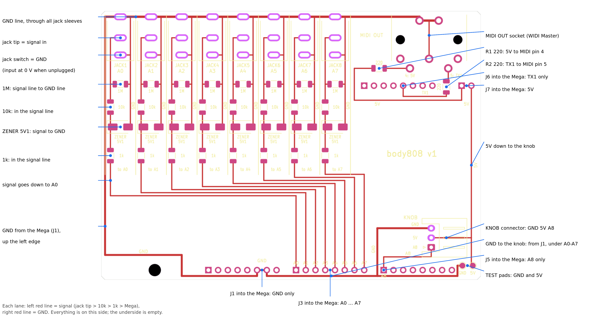
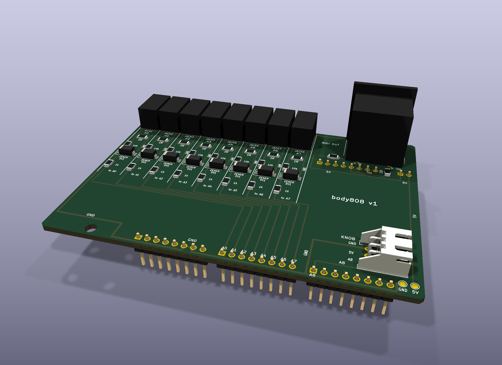
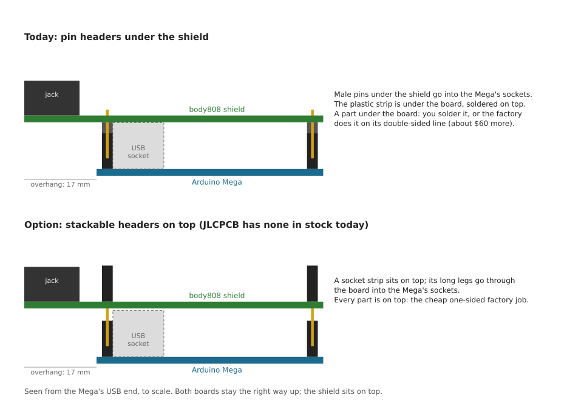
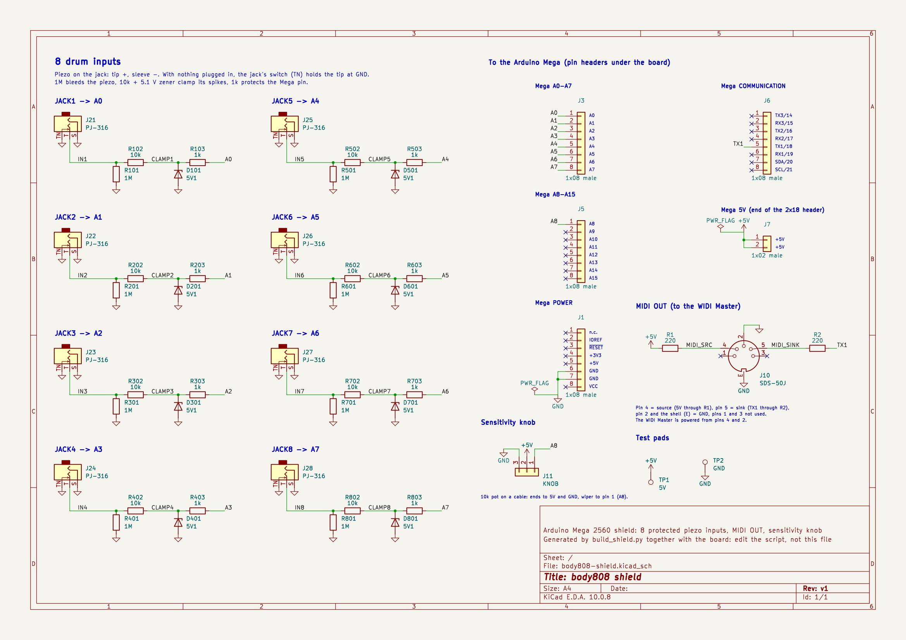

# body808 shield

A board that plugs on top of the Arduino Mega 2560 and replaces the breadboard. It has
8 protected drum inputs on side-entry 3.5 mm jacks, the MIDI OUT socket for the WIDI
Master, and a flat connector for the sensitivity knob. It overhangs the Mega by 17 mm on
the digital-pin side, so that every connector sits on one edge and all cables leave on
the same side.





## How it stacks

Both boards stay the right way up: the shield sits on top of the Mega, and the pin
headers under it plug into the Mega's sockets. The jacks and the MIDI socket are on the
part that overhangs the Mega.



The second drawing shows the alternative with stackable headers on top, which would let
the factory solder everything in its cheaper one-sided service. In November 2026 JLCPCB
had no stackable header in stock, so the board keeps the headers underneath.
`stacking.py` draws this picture.

## Schematic



To print it, use [body808-shield-schematic.pdf](body808-shield-schematic.pdf). To open it in KiCad, open
`body808-shield.kicad_pro`: the schematic and the board are one KiCad project, linked
part by part. Every check (`make_fab.sh`) runs KiCad's schematic-parity test, which
fails if the board and the schematic disagree on a single part, value or connection.

## How to read the drawing

**Everything is on the top side**, ground included. The underside has no copper
except the pads of the through-hole parts. Every red line you see on top is a real
connection.

**Lanes:** each jack has its own lane, separated by white lines, laid out like its
schematic:

```
    JACK (on the edge)
      sleeve ●──────────┐
         tip ●──┐       │       right line = GND (from the jack's sleeve and switch pins)
      switch ●──┼───────┤
                ├─[1M]──┤       1M and the zener lie flat: from the signal line to GND
              [10k]     │
                ├[ZENER]┘
               [1k]
                │               left line = signal: tip -> 10k -> 1k
             to A0 ... A7 (header into the Mega)
```

**Ground is one line.** It leaves the Mega's GND pins (J1) at the bottom, runs to the
far left, goes up the left edge, then straight across the top through every jack's
sleeve pin, and on to the MIDI socket. Each lane's GND line drops straight down from it,
marked `GND`, and picks up the jack's switch pin on the way. The knob connector gets its
GND from J1 too, along the bottom edge under the A0–A7 pins.

**When nothing is plugged in:** the jack's switch connects the tip to GND, so an empty
input reads 0 and plays nothing.

**The right part of the board:**

- the MIDI socket in the top-right corner, with R1 and R2 under it;
- 5V coming down from the Mega's 5V pins (J7) to the knob connector at the lower right;
- the two test pads below the knob, 5V and GND.

**Labels:** every line has a short label printed next to it (`GND`, `5V`, `TX1`, `A8`,
`220`, the MIDI pin numbers), instead of a legend block. The title is `body808 v1`.

**What goes into the Mega:** only the pins that carry something.

| Header | Pins used | For |
|--------|-----------|-----|
| J1 (POWER) | GND | ground |
| J3 (A0–A7) | all 8 | one per lane |
| J5 (A8–A15) | A8 | knob |
| J6 (comms) | TX1 (pin 18) | MIDI |
| J7 (2 pins at the end of the 2×18 header) | 5V | MIDI and knob |

The other pins of J1, J5 and J6 are only there to hold the shield and aren't connected.

## Connectors

| Ref | What | Wiring |
|-----|------|--------|
| J21–J28 | `JACK1`–`JACK8` (PJ-316 mono jacks) | → A0 … A7. Tip (T) = piezo red, sleeve (S) = GND, switch (TN) = GND |
| J10 | MIDI OUT (DIN-5, CUI SDS-50J) | pin 4 → R1 220 Ω → 5V, pin 5 → R2 220 Ω → TX1, pin 2 + shield → GND, pins 1 and 3 unused |
| J11 | `KNOB` (flat JST-XH, 3 pins) | GND / 5V / A8, as printed next to it |
| TP1, TP2 | Test pads, bottom right | 5V and GND, for a multimeter |

**MIDI uses only 3 of the 5 pins**, which is the MIDI standard. The WIDI Master takes
its power from pin 4 (5V through 220 Ω) and pin 2 (GND), so it needs no other supply.

**Each lane** is the protection circuit from [docs/hardware.md](../../docs/hardware.md):

| Part | Value | Position in the lane |
|------|-------|----------------------|
| R1 | 1 MΩ | flat, signal line to GND line |
| R2 | 10 kΩ | in the signal line |
| D1 | 5.1 V zener, 1SMA4733A | flat, cathode band on the signal line |
| R3 | 1 kΩ | in the signal line, then to the Mega pin |

1SMA4733A is the SMD version of the 1 W 1N4733A that the simulation favours.

If real pads turn out to give more than ~3 V
([docs/simulation.md](../../docs/simulation.md)), the 100 nF capacitor can go across
the piezo inside the pad. That's electrically the same place, so the board doesn't need
a spot for it.

**Clearances:**

- **Piezo inputs:** the line from each jack tip to its 10k sees the piezo's spikes
  (50–200 V, well under a millisecond). It keeps at least 0.8 mm from GND copper,
  including the jack's own GND pins.
- **Other tracks:** at least 0.5 mm apart (A0–A7 lines, 5V and TX1).
- **Board edge:** at least 0.75 mm from copper.

**Nothing pokes into the Mega.** Over the Mega's USB socket, power jack and ICSP header
there are no solder joints and no bottom copper. Over the Mega, only the pin headers
and the knob connector's 3 pins go through the board, and nothing tall sits under the
knob connector. The jacks and the MIDI socket are on the overhang.

## Order it (JLCPCB)

The BOM uses LCSC part numbers, so JLCPCB can assemble the board. `fab/` holds the three
files to upload, nothing else.

1. On jlcpcb.com, upload `fab/gerbers-jlcpcb.zip`. The defaults are fine (2 layers,
   1.6 mm). Pick **lead-free HASL**, since the board will be worn.
2. Enable **PCB Assembly**, **Economic**, top side, 2 or 5 boards. Upload
   `fab/bom-jlcpcb.csv` and `fab/cpl-jlcpcb.csv`.
3. The files ask the factory to solder **everything on the top**: the 34 resistors and
   zeners, the 8 jacks, the MIDI socket and the knob connector. The **pin headers are
   left out on purpose**: they sit on the bottom, and a bottom-side part moves the
   order to double-sided assembly (about $60 more). Solder them yourself (see below).
4. **Check the placement preview** before paying:
   - **Zeners D101 … D801:** each lies flat across its lane. The cathode band must be
     on the **left, on the signal line**. A reversed zener gives no protection.
   - **Jacks and MIDI socket:** facing out of the top edge.
   - **Knob connector:** opening toward the right edge.

   Rotate anything that looks wrong in the preview: rotation conventions differ between
   KiCad and JLCPCB.

**Pin headers, by hand:** 4 strips of 8 (J1, J3, J5, J6) and one of 2 (J7, cut from a
strip), 2.54 mm male, plastic **under** the board, soldered from the top. The easy way
to get them straight: push them into the Mega's sockets, put the shield on top,
solder, then lift it off. LCSC C492407 is a strip of 8.

**What it costs** (researched 2026-11-05, USD before shipping and VAT):

| | 2 boards | 5 boards |
|---|---|---|
| Factory solders everything on top (the files as they are) | ~$40 | ~$63 |
| Factory solders only the 34 small parts, you buy and solder the rest | ~$36 | ~$57 |
| Bare boards only, no parts | ~$5 for 5 | |

- **Where it goes:** the MIDI socket ($4.27 each) and the jacks ($0.22 each) are most
  of the parts cost. The assembly setup is about $8 and the stencil $1.50 per order,
  whatever the quantity.
- **Shipping to France:** about $7–9 for the slow options, about $30 by DHL.
- **VAT and duty:** French VAT (20%) is added at checkout. Since July 2026 each EU
  parcel also pays a flat €3 customs duty per goods category, plus a few euros of handling fees.
  JLCPCB collects that at checkout on some shipping routes; on others it's charged on
  delivery.
- **The famous "$2 for 5 boards"** is now only in JLCPCB's desktop app, which runs on
  Windows and macOS (not Linux); on the website it's about $4.
- **Stock:** the MIDI socket (C6216157) and the Kinghelm jack (C5123139) were low (138
  and 272 left). If the jack runs out, the CAX PJ-316 (C50176628) is a drop-in
  replacement.

Bare boards (no assembly) can also come from PCBWay or Aisler (made in Germany, no
customs for the EU) with the same Gerber zip. You then solder the 1206 parts by hand;
that size is easy with a fine tip.

Part numbers, in case one is out of stock: [build_shield.py](build_shield.py) (`LCSC = {...}`).
The jack has a drop-in second source, CAX PJ-316 (C50176628).

## Before plugging it into the Mega

- Put a piece of Kapton or electrical tape on top of the Mega's USB socket. It reaches
  the underside of the shield.
- Do the multimeter checks from
  [docs/hardware.md](../../docs/hardware.md#check-before-plugging-into-the-mega) on each
  lane, measuring at the jack (tip) and the A0 … A7 header pins.
- Once it's on the Mega and powered, check about 5 V between the test pads at the bottom
  right.
- Tap softly first, with `CALIBRATE 1`.

## Firmware for the shield

Three changes in `body808.ino`:

- `pads[]` gets two more lines, for A6 and A7 (`JACK7`, `JACK8`). Pick their sounds from
  the General MIDI drum map (for example 41 low tom, 49 crash).
- `SENSITIVITY_PIN` becomes `A8`; the knob moves there because A6 and A7 are now pads.
- `MIDI_MODE_SERIAL` sends to the MIDI OUT socket (TX1).

## Regenerate

The board is generated by a script; nothing was drawn by hand. To change something,
edit `build_shield.py` and run:

```sh
hardware/shield/make_fab.sh    # board, DRC, Gerbers, BOM, CPL, renders, annotated view
```

- **Needs:** the KiCad Flatpak (`flatpak install --user flathub org.kicad.KiCad`) and
  ImageMagick.
- **3D models:** KiCad has no model for the PJ-316 jack and the SDS-50J socket. The script
  writes simple ones from the datasheet sizes into `3d/`.
- **DRC:** it stops if KiCad's design-rule check finds an error.
- **Checks:** ERC on the schematic, DRC on the board, and schematic parity between the two.
  The script stops at the first one that fails; the reports are in `.work/`.
- **Editing in KiCad:** open `body808-shield.kicad_pro` in KiCad, or the board directly
  (`flatpak run --command=pcbnew org.kicad.KiCad hardware/shield/body808-shield.kicad_pcb`).

**After editing by hand, export with `--no-build`:**

```sh
hardware/shield/make_fab.sh --no-build    # DRC, Gerbers, CPL, renders from the edited board
```

- **Why:** running `build_shield.py` (or `make_fab.sh` without `--no-build`) regenerates
  the board from scratch, which **overwrites manual edits**.
- **What doesn't follow your edits:** the BOM and the schematic only change when parts
  change, and the callouts in `shield-explained.png` use fixed positions.

## Files

| File | What |
|------|------|
| `build_shield.py` | Builds the board, then the schematic from the board's nets |
| `schematic.py` | Draws the schematic (used by `build_shield.py`) |
| `make_fab.sh` | Runs the generator, the checks, and every export |
| `body808-shield.kicad_pro` / `.kicad_pcb` / `.kicad_sch` | The KiCad project (generated) |
| `body808.pretty/`, `body808.kicad_sym` | Footprints and symbols for the parts KiCad lacks: the PJ-316 jack and the SDS-50J socket (generated) |
| `fp-lib-table`, `sym-lib-table` | Tell KiCad where those two libraries are |
| `3d/` | Simple 3D models of the same two parts (generated) |
| `fab/` | The JLCPCB upload: Gerber zip, BOM, placement (generated) |
| `body808-shield-schematic.pdf`, `images/` | Schematic (PDF to print) and pictures for this page (generated) |
| `annotate.py` | Adds the callouts to `images/shield-explained.png` |
| `stacking.py` | Draws the side view `images/shield-stacking.svg` |
